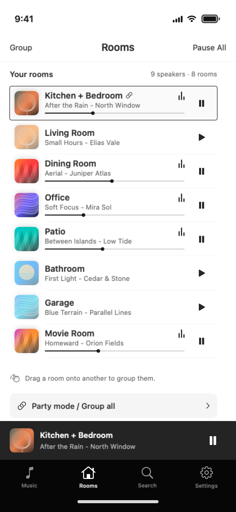
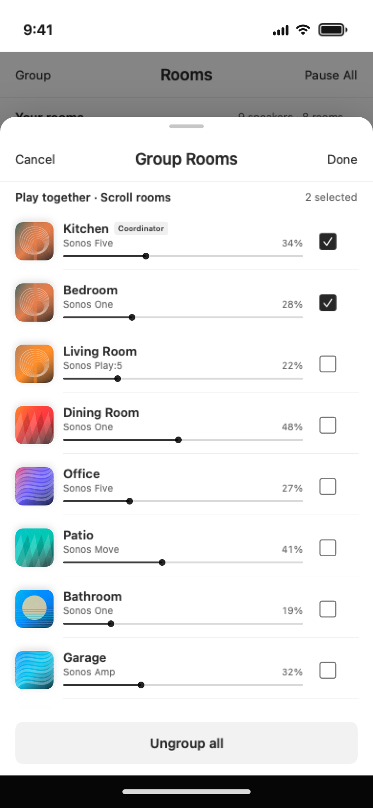
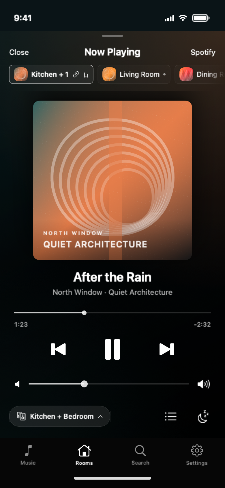
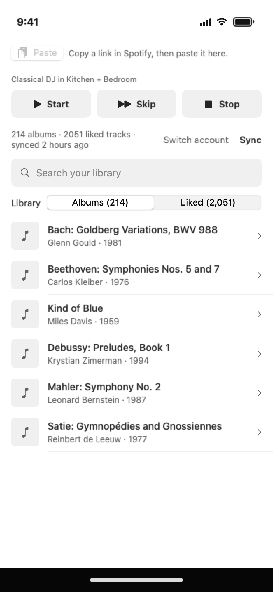
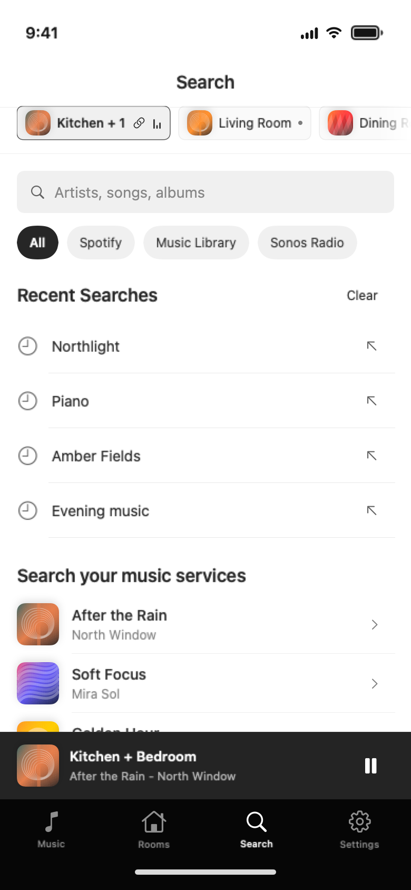

# FrankenSonos for iPhone

A SwiftUI remote for the FrankenSonos daemon. It talks to the daemon's HTTP
API on your LAN or tailnet and never to a speaker.

```text
iPhone ── Bonjour _fsonos._tcp ──▶ finds the daemon
iPhone ── HTTP + SSE ────────────▶ fsonos serve ── UPnP ──▶ speakers
iPhone ── Spotify PKCE consent ──▶ POST /auth/spotify/exchange (the daemon keeps the tokens)
```

The tabs are Music (your Spotify library, the classical DJ, paste a link to
play it), Rooms, Search (all of Spotify), and Settings. Now Playing is the
full-screen player. Siri and Shortcuts get pause, resume, and favorites. The
room checkboxes add speakers to and remove them from the selected group.

Screenshots use the app's mock data (`-mock`), not a real house.

| Rooms | Group rooms | Now Playing |
|---|---|---|
|  |  |  |

| Music | Search |
|---|---|
|  |  |

Regenerate them with `swift run --disable-sandbox SketchShots <output dir>`
from `ios/`.

The daemon routes the app calls are listed in
[docs/DEPLOY.md](../docs/DEPLOY.md), under "The iPhone app".

## Build

```bash
brew install xcodegen
cd ios
xcodegen generate
xcodebuild -project FrankenSonos.xcodeproj -scheme FrankenSonos \
  -destination 'generic/platform=iOS Simulator' CODE_SIGNING_ALLOWED=NO build
```

`project.yml` carries the bundle id `com.samuelreed.frankensonos`. Before you
run on a device, set your own `bundleIdPrefix`, `PRODUCT_BUNDLE_IDENTIFIER`,
and development team.

## Test

```bash
# Model logic, no daemon needed.
swiftc -swift-version 5 FrankenSonos/Model/*.swift FrankenSonos/Net/*.swift \
  check-mock-state.swift -o /tmp/mock-check && /tmp/mock-check

# The app's store against a simulated house, plus a stub daemon for the
# Spotify screens. Run `cargo build --release` first. No speaker is touched.
tools/e2e-live
```

`Tests/RealHouseCheck.swift` is opt-in. It drives real speakers in one named
zone and skips unless `FSONOS_REAL_HOUSE_URL` and `FSONOS_REAL_HOUSE_ZONE`
are set.
